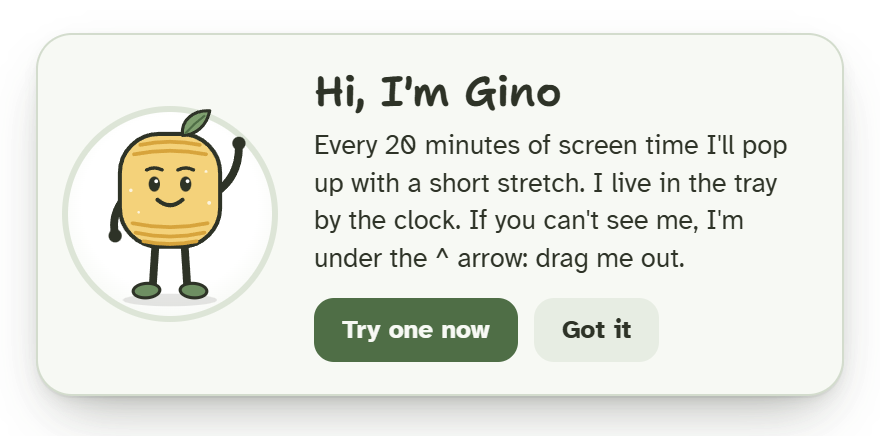
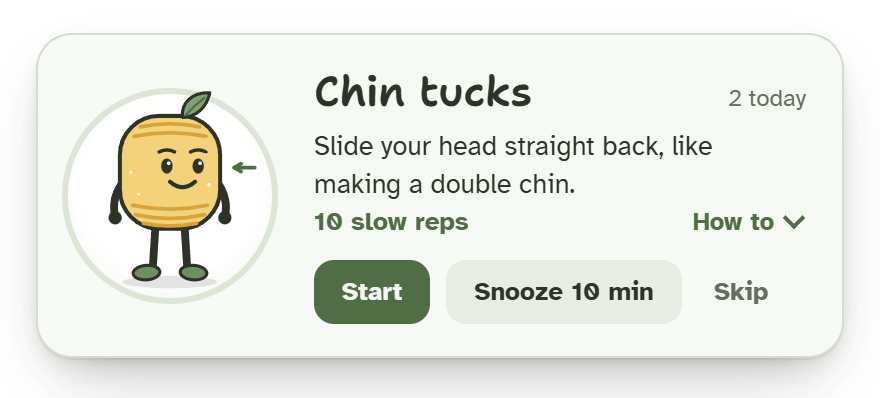
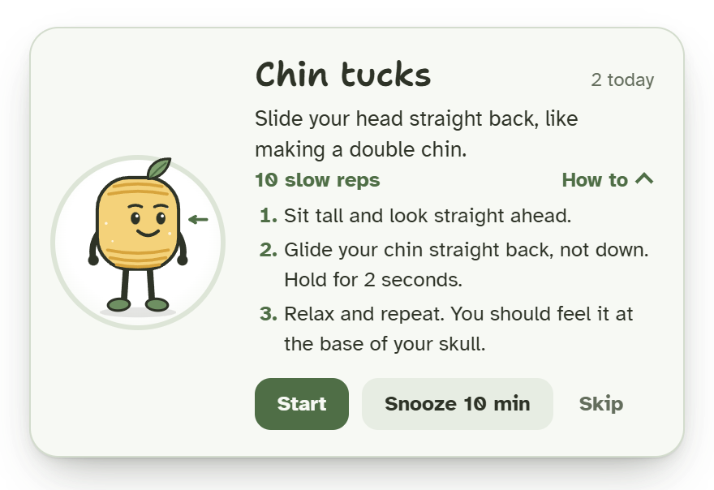
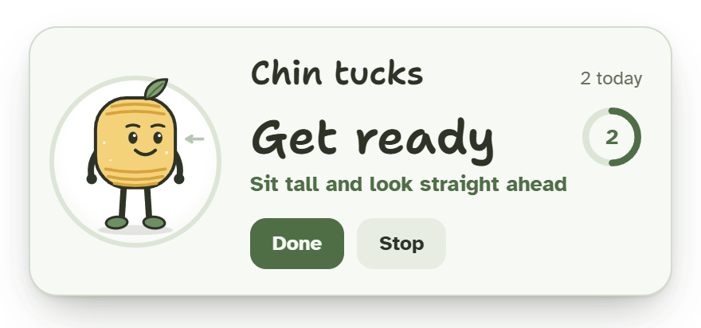
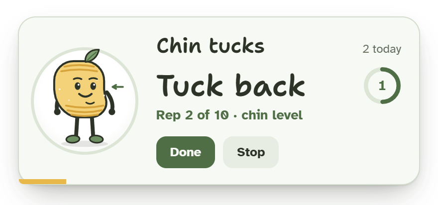
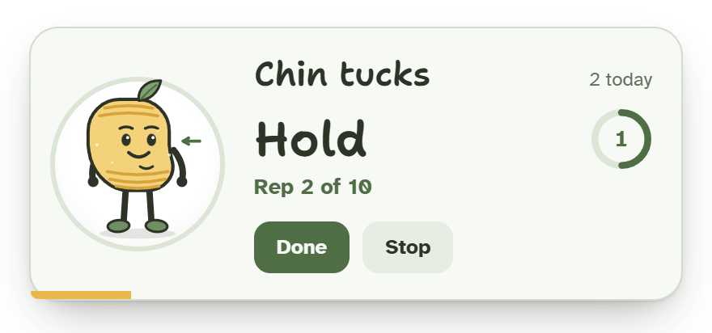
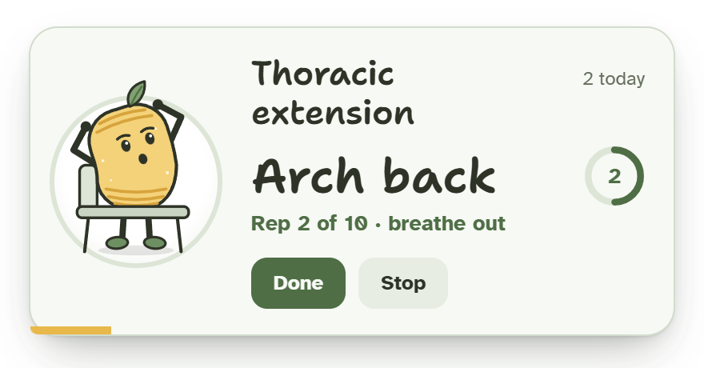
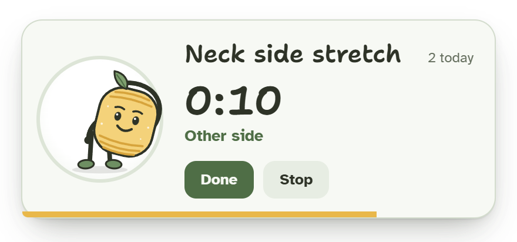
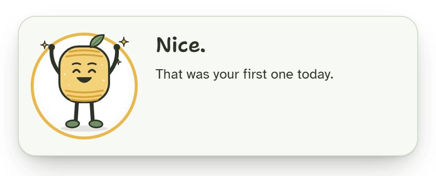

# Gino Desk Stretch: user guide

Everything Gino shows you, what each button does, and what to do when something doesn't look right.
To install Gino, see the [README](../README.md#download-and-install).

- [Getting started](#getting-started)
- [When Gino pops up](#when-gino-pops-up)
- [The card](#the-card)
- [The stretches](#the-stretches)
- [The tray menu](#the-tray-menu)
- [Where the card appears](#where-the-card-appears)
- [Holding off during calls (Windows)](#holding-off-during-calls-windows)
- [Your data](#your-data)
- [Troubleshooting](#troubleshooting)

## Getting started

The first time Gino starts, he says hello.

**Try one now** brings up the first stretch straight away. **Got it** closes the card, and the first
stretch comes after 20 minutes of screen time.

After that, Gino lives in the tray by the clock on Windows, or in the menu bar on macOS. On Windows 11,
new tray icons hide under the **^** arrow next to the clock: drag Gino out onto the taskbar so you can
see him. To have him start when you sign in, click his icon and tick **Start with Windows** (Windows)
or **Open at login** (macOS).

## When Gino pops up

Gino counts **active screen time**: the minutes you're actually using the keyboard or mouse. After 20
of them (you can change this), a stretch card pops up.

These count as a break, and the count starts over:

- 5 minutes without touching the keyboard or mouse
- locking the screen
- the computer going to sleep

If a card is on screen when you step away for 5 minutes or lock the screen, Gino puts it away and
starts the count over. You won't come back to a stale card.

## The card

### The reminder

The card shows the stretch, a one-line instruction and the dose (for example "10 slow reps"). Gino
loops the move to show you how it's done. The number in the corner is how many stretches you've done
today.

| Button | What happens |
| --- | --- |
| **Start** | Runs the guided timer. |
| **Snooze 10 min** | Hides the card and asks again in 10 minutes. |
| **Skip** | No stretch this time. The next one comes after a full interval. |
| **How to** | Opens the steps. While they're open, the card won't snooze itself. |

If you don't touch the card, it snoozes itself after 4 minutes and slides away. The card pops up
without taking your keyboard focus, so whatever you're typing carries on where it was.

### The guided timer

Press **Start** and the card counts you through the stretch.

1. **Get ready** (3 seconds), with a line telling you how to set up. The walkaround skips this.
2. **The stretch.** For the guided-rep stretches, the card calls out each part of every rep. The ring
   on the right counts down the seconds left in that part, the line underneath says which rep you're
   on, and Gino does the move in time with you. Other stretches show a clock.
3. The yellow bar along the bottom shows how far through the whole stretch you are.

  
  

  
  

For the neck side stretch, Gino switches sides halfway, and the card says "First side" or "Other side".

While the timer runs, **Done** finishes now and counts the stretch, and **Stop** ends it without
counting it.

### When you're done

When the timer ends, or you press **Done**, Gino celebrates and tells you how many you've done today.
After **Snooze**, **Skip** or **Stop**, the card says when the next one comes. Each of these closes by
itself after about two seconds.

### Animations

Gino's demonstrations always play, because they show you how the stretch is done. If your computer is
set to reduce motion (on Windows: **Settings › Accessibility › Visual effects › Animation effects**
turned off), the decorative touches stop: the card sliding in, Gino blinking, the sparkles when you
finish.

## The stretches

Gino goes through them in this order. The walkaround takes every third turn, so it comes up about once
an hour at the default interval.

| Stretch | Dose | How the timer runs |
| --- | --- | --- |
| Sit up straight | 15 seconds | Get ready, then a 15-second hold |
| Chin tucks | 10 slow reps | Each rep: Tuck back 2 s, Hold 2 s, Relax 1.5 s (55 s in all) |
| Neck side stretch | 20 seconds each side | Get ready, then 20 s on each side |
| Eye break | 20 seconds | Get ready, then 20 s |
| Thoracic extension | 10 slow reps | Each rep: Arch back 3 s, Hold 1 s, Come up 2 s (1 minute in all) |
| Shoulder rolls | 10 slow circles | Each rep: Shrug up 1.5 s, Squeeze back 1.5 s, Drop down 1.5 s (45 s in all) |
| Walkaround | 2 minutes | Every third turn: get up, walk, and refill your water |

**Stretch now** in the menu takes the next one in the rotation, just like a reminder does.

To change the stretches or their timings, see [Customizing Gino](customizing.md).

## The tray menu

Click (or right-click) Gino's icon.

| Item | What it does |
| --- | --- |
| *Next stretch in 14 min* | The status line, for reading only. It can also say *Stretch on screen*, *Paused until 15:30* or *Holding off: you seem to be on a call*. Hovering the icon shows the same line. |
| *Done today: 2* | Today's count (*No stretches yet today* before the first). |
| **Stretch now** | Shows the next stretch right away. Greyed out while a card is up. |
| **Pause** | For 30 minutes, 1 hour, 2 hours, or until tomorrow morning (6:00). While paused, this becomes **Resume**. |
| **Remind me every** | 15, 20, 30, 45 or 60 minutes of active screen time. |
| **Hold off during calls and full-screen apps** | Windows only. See [below](#holding-off-during-calls-windows). |
| **Start with Windows** / **Open at login** | Starts Gino when you sign in. |
| **Reset card position** | Puts the card back in its corner. Greyed out until you've dragged the card. |
| **Quit Gino** | Closes Gino until you start him again. |

## Where the card appears

The card pops up in the bottom-right corner of your **main** screen: the one Windows calls "main
display" (**Settings › System › Display**), or the one with the menu bar on a Mac.

To move it, drag it by its body (anywhere except the buttons). It comes back to that spot next time,
on whichever screen you put it. If that screen is unplugged, the card goes back to the main screen's
corner. **Reset card position** in the menu puts it back in the corner at any time.

## Holding off during calls (Windows)

With **Hold off during calls and full-screen apps** ticked (it's on by default), a stretch that comes
due waits while:

- an app has your microphone open (a call or a meeting),
- an app or game is full screen,
- Windows is in presentation mode,
- the screen is locked.

The tray tooltip says why Gino is waiting, for example *Holding off: you seem to be on a call*. He
checks again once a minute and pops up as soon as the moment has passed. To find out whether an app
has the microphone open, Gino reads the record Windows keeps of which apps are using the microphone
(the one behind **Settings › Privacy & security › Microphone**). He asks Windows directly, so
nothing else starts up to check. He never listens to or records anything.

## Your data

Gino keeps two small files:

| File | What's in it |
| --- | --- |
| `settings.json` | Your interval, the hold-off setting, where you dragged the card, and whether you've seen the welcome |
| `stats.json` | How many stretches you did each day (kept for about three months), and where you are in the rotation |

They live in `%APPDATA%\Gino` on Windows and `~/Library/Application Support/Gino` on macOS. Delete
them to start fresh: Gino says hello again next time. Gino never connects to the internet.

On Windows, WebView2, the engine that draws the card, keeps its own working files in
`%LOCALAPPDATA%\com.gino.stretch\EBWebView` (about 10 MB): caches for drawing the card, a small
history of the card page, WebView2's own settings and IDs, and a folder for crash reports. It's safe
to delete while Gino is closed.

Uninstalling Gino on Windows keeps your settings and counts, unless you tick **Delete the application
data**.

## Troubleshooting

**I can't find Gino.**
On Windows 11, click the **^** arrow next to the clock. Drag Gino from there onto the taskbar. On a
Mac, look in the menu bar at the top right. Or start Gino again, from the Start menu on Windows or
from Applications on a Mac: his welcome card pops up and says where he lives.

**Windows says "Windows protected your PC".**
Gino isn't code-signed yet. Click **More info**, then **Run anyway**.

**The installer says the old version of Gino could not be removed.**
Open **Settings › Apps › Installed apps**, find the older Gino and uninstall it. Your settings and
counts stay.

**macOS won't open Gino, or says it "is damaged".**
Gino isn't signed by Apple yet. Open **System Settings › Privacy & Security**, scroll down and click
**Open Anyway** next to Gino. If macOS says Gino is damaged, run `xattr -cr /Applications/Gino.app`
in Terminal once, then open it again.

**Gino hasn't popped up for a long time.**
Hover over his icon to see why. He might be paused, or holding off because an app has the microphone
open. Remember that only active screen time counts: reading without touching the mouse for 5 minutes
starts the count over.

**The card shows up on the wrong screen.**
Check which screen is your main display, or drag the card where you want it. **Reset card position**
puts it back in the main screen's corner.

**Gino barely moves.**
His demonstrations always play. If the card itself doesn't slide in and Gino doesn't blink, your
computer is set to reduce motion; that's on purpose.

**Starting Gino again just shows his welcome card.**
Only one Gino runs at a time. Starting him again, on Windows or on a Mac, shows the welcome card of
the one that's already running, which says where to find him. If a card is already up, nothing
changes.

**I updated Gino and the card is back in its corner.**
Gino forgets where you dragged the card once, when you update from 0.2. Drag it back and he
remembers it again.
